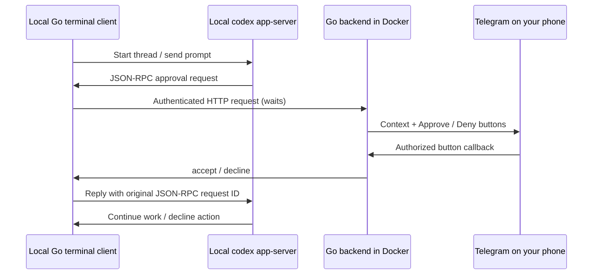

# Codex Telegram Approve

Approve local Codex actions from your phone using Telegram buttons. A Go service
runs in Docker; a host-side terminal launcher runs Codex in your real workspace.
The backend has no workspace mounts, Codex credentials, or shell execution API.

**Status:** initial implementation. Automated tests simulate Telegram and Codex;
a live bot/account is required to verify your actual setup.

## How it works



For the full Codex terminal UI and existing HUD wrappers such as `cx`, use the
native plugin approval hook below. The separate `scripts/codex-telegram` launcher
remains available as a basic App Server client.

## Native terminal UI and HUD

Requires Python 3 and a Codex CLI with `PermissionRequest` hooks (checked locally
with 0.162.1). After configuring and starting the backend:

```bash
python3 scripts/configure-hook.py
codex plugin add codex-telegram-approve@codex-telegram-approve-local
```

Restart your normal `cx` or `codex` session. Open `/hooks`, review and trust the
Telegram `PermissionRequest` hook. Plugin installation alone does not trust it.
Once trusted, the configured user hook routes gated approvals using the selected mode;
no startup prompt or replacement terminal client is needed. Your existing approval
policy and sandbox still determine which actions require approval. For a test,
launch `cx --ask-for-approval untrusted` and ask for a harmless command.

### Computer and Telegram modes

Computer is the default, including after upgrading an existing installation. It
returns control to Codex's normal approval flow immediately without contacting
Telegram. Telegram mode sends the request to Telegram and waits for its decision.
Neither mode changes your Codex approval policy or sandbox.

Run these commands from this checkout in another terminal while Codex is running:

```bash
./scripts/approval-mode status
./scripts/approval-mode telegram
./scripts/approval-mode computer
./scripts/approval-mode toggle
```

The setting is shared across this user's sessions and stored atomically in
`~/.config/codex-telegram-approve/mode.json`. Each request reads it once, so
switching affects new requests only. A pending Telegram request still needs a
Telegram decision or cancellation of the requesting operation in Codex.
Malformed mode settings deny requests; explicitly select `computer` or
`telegram` to repair the file. This toggle applies to the native hook, not the
separate App Server launcher.

To display `Approval mode (next): Computer` or `Telegram` in an existing
codex-hud environment line:

```bash
python3 scripts/install-hud-mode.py /path/to/codex-hud
cd /path/to/codex-hud
npm run build
```

Restart `cx` once to load the updated HUD. Later mode switches appear on the
HUD's next refresh without restarting. The indicator shows the configured
handler, not hook trust or bridge health; `/hooks` still controls whether Codex
runs the handler. Review the changed hook again there after upgrading. This
integration changes the HUD wrapper, without requiring a custom Codex build.

### Custom Codex: concurrent approval and native slash commands

The patch in `patches/codex-0.162.1-concurrent-approvals.patch` targets Codex
0.162.1 (commit `092d3acd6bec3e3a14bdc7e7a2810ab628ab759d`). It adds a native
`/approval-mode` command and an optional concurrent Telegram reviewer in Codex's
App Server. Ordinary policy hooks still run before reviewer approval. Our
Telegram hook defers in concurrent mode so it cannot steal the native prompt.

Build with Rust 1.95 and Codex's native build prerequisites installed:

```bash
./scripts/build-custom-codex
./bin/native/codex --no-daemon
```

The build script uses an isolated source checkout and leaves the installed Codex
executable unchanged. `--no-daemon` ensures the terminal uses the patched server.
To use the build with the existing `cx` HUD from this checkout:

```bash
PATH="$PWD/bin/native:$PATH" cx --no-daemon
```

Inside the patched terminal:

```text
/approval-mode concurrent
/approval-mode concurrent 5
/approval-mode computer
/approval-mode telegram
/approval-mode status
```

Rebuild the bridge backend from this checkout before enabling concurrent mode.
The patched reviewer requires an explicit phone-vote source in the bridge's
response, so an older backend or an expired request falls back to the terminal
instead of being mistaken for a phone denial.

Concurrent mode shows the native approval immediately and sends the same request
to Telegram. A terminal response wins immediately. A Telegram vote starts a
five-second override window (configurable from 1 to 60 seconds); the terminal
can override either phone vote until the server commits it. The native prompt
shows the countdown. If Telegram is unavailable or its response is invalid,
the request stays available for terminal approval. Cancellation drops the
outstanding bridge request and stale responses cannot authorize execution.

Phone votes are provisional: the Telegram card records the vote, while the
native terminal owns the final outcome. File approvals include the complete
changes; permission approvals grant only the requested permissions for the turn.

For the existing standalone toggle, use
`./scripts/approval-mode concurrent --veto-seconds 5`. Stock Codex in concurrent
mode uses only native approval; concurrent Telegram review requires the patched
server. Settings affect new requests across this user's sessions, including
sessions using another Codex build.

The hook reads only the bridge credential from the checkout's `.env`, handling
Windows CRLF. Configuration in `~/.config/codex-telegram-approve/hook.json` stores
only the checkout path and bridge URL. No bot token is copied into plugin cache.
All native hook events retain their full tool input in the Telegram preview.
In Telegram mode, bridge failure, delivery failure, invalid responses and timeout return an explicit
denial. Untrusted or disabled hooks are skipped by Codex and use its normal flow.
The hook waits up to 1,850 seconds; the backend's configured approval timeout
(default five minutes, maximum 30 minutes) normally expires first.

The setup script merges the handler into `~/.codex/hooks.json` (or your configured
`CODEX_HOME`), preserving existing hooks. This is a compatibility workaround:
0.162.1 did not discover the bundled hook in our runtime check. Bundled declarations
are disabled to avoid duplicates. The handler stays in this checkout, so keep it
available. Plugin installation alone does not register or remove the user hook.

To stop forwarding, disable the user hook in `/hooks`. Review a
changed hook again after upgrades. Python hook checks run with:
`python3 -m unittest discover -s tests -v`.

## Install as a Codex plugin

This repository includes a custom marketplace and a setup/troubleshooting
plugin. The plugin is deliberately in `plugins/codex-telegram-approve/`, so
installing it never copies your `.env` or application files into the plugin cache.

From this repository, register the marketplace:

```bash
codex plugin marketplace add .
codex plugin list --marketplace codex-telegram-approve-local --available --json
```

Restart Codex, open `/plugins` (or the plugin browser command shown in your
client), choose **Codex Telegram Approve**, and install the plugin. On CLI
versions with plugin installation commands, you can also run:

```bash
codex plugin add codex-telegram-approve@codex-telegram-approve-local
```

In a new chat, ask Codex to use the plugin to set up or troubleshoot Telegram
approvals. The bundled skill is named `telegram-approvals`. Tell it where your
application checkout lives; optionally set `CODEX_TELEGRAM_APPROVE_ROOT` in your
terminal environment to that path.

Installation bundles setup guidance and a native approval hook. Configure the
backend and hook, then review it in `/hooks` as described above.

This custom marketplace is separate from OpenAI's public directory. To share it
through GitHub, commit and push the marketplace and plugin files, then other
users can add the repository using `codex plugin marketplace add OWNER/REPO`.
Their bot configuration remains local. Public directory discovery requires a
separate submission and review; nothing is publicly published by these commands.

## Requirements

- Linux/macOS or WSL with Bash, Go 1.24+, and OpenSSL for setup.
- Docker Engine and Docker Compose v2 for the backend.
- A locally installed, signed-in `codex` CLI (`codex login`).
- Your own Telegram bot and numeric user/chat IDs.

Protocol fields were checked against local `codex-cli 0.162.1` schemas. App Server
is evolving; use a current CLI and report protocol errors rather than disabling
approval or sandboxing.

## Setup

1. Build the host-side launcher:

   ```bash
   make build
   ```

2. Create a bot in Telegram using **@BotFather**, then open your bot and send
   `/start`. For a group, add the bot and send a command addressed to it there.

3. Discover your IDs. Enter the token in your own terminal, not in a Codex chat:

   ```bash
   read -rsp 'Bot token: ' TELEGRAM_BOT_TOKEN; echo
   export TELEGRAM_BOT_TOKEN
   ./bin/codex-telegram-approve pair
   unset TELEGRAM_BOT_TOKEN
   ```

   Send `/start` again while `pair` runs. It prints the sender's user ID and chat
   ID, never message text or the bot token. Use **your** sender ID as the allowed
   user; a group chat ID is typically negative. Press Ctrl-C when done. Run only
   one poller per bot: stop `pair` before starting the backend.

4. Run the local setup wizard. It asks for the token with hidden input, asks for
   the two IDs, and generates a separate random bridge credential:

   ```bash
   bash scripts/setup.sh
   ```

   It creates an ignored `.env` file with mode `600` and refuses to overwrite an
   existing file. Under WSL `/mnt/c`, Windows ACLs still govern access; use Linux
   home storage for `.env` if you need Linux permission enforcement.

5. Start the backend:

   ```bash
   docker compose up -d --build
   curl --fail http://127.0.0.1:8787/healthz
   ```

6. Start a session in any project:

   ```bash
   ./scripts/codex-telegram --cwd /path/to/project
   ```

   Type a prompt and press Enter. When Codex requests approval, review the
   Telegram context messages and press a button. `/quit` or Ctrl-C exits.
   Ordinary sandboxed work that Codex does not gate proceeds without a prompt.

   For one prompt, with more frequent approval requests:

   ```bash
   ./scripts/codex-telegram --cwd /path/to/project \
     --approval untrusted --prompt 'Inspect this project and run its tests'
   ```

   The client prints the thread ID. Continue it later with:

   ```bash
   ./scripts/codex-telegram --cwd /path/to/project --resume THREAD_ID
   ```

   Stop the other client before resuming a thread. Concurrent thread ownership
   and control of another running client are not implemented.

If Docker needs sudo, use `sudo docker compose ...` for container commands. Run
the terminal client as your normal user so it finds your Codex login.

## Instructions to give Codex

> Read this repository's README. Build and test the Go client and Docker backend.
> Guide me through creating my own Telegram bot and entering its token locally
> using scripts/setup.sh. Do not ask me to paste the token in chat, print .env,
> commit secrets, change global Codex approval settings, or disable the sandbox.
> After setup, help me launch a fresh session with scripts/codex-telegram.

The README guides installation. The executable bridge carries the actual
approval decision; agent instructions alone cannot implement that protocol.

## Supported requests

| Codex request | Approve | Deny |
| --- | --- | --- |
| `item/commandExecution/requestApproval` | `accept` for this request | `decline` |
| `item/fileChange/requestApproval` | `accept` for this request | `decline` |
| `item/permissions/requestApproval` | Grant requested permissions for the current turn | Grant no permissions |

Telegram shows an HTML approval card with the action, workspace, reason, command
or patch preview, scope and expiry. Complete request context (including file
diffs when supplied by Codex) is preserved in expandable detail messages. Long
context is split without truncation; buttons appear only after all detail
messages succeed. Cards update to Approved, Denied, Expired or Cancelled and
remove the buttons after resolution. Requests
over 30,000 bytes of rendered context are denied rather than shown incompletely.

Unanswered requests expire after five minutes by default. Backend outages,
delivery errors, invalid responses, and oversized previews fail closed. Client
disconnects cancel the pending HTTP request. Decisions are not persisted across
backend restarts; old buttons cannot approve new requests.

The launcher requests `workspace-write`, routes approvals to the user, and uses
`on-request` (or `--approval untrusted`). There is no "always approve" button or
permanent policy amendment. Existing Codex policies and trusted command rules
still determine which actions trigger approval.

This version does not implement free-text questions, plan-mode user input,
MCP elicitation, or connector-specific approval forms. Unsupported server requests
receive a protocol error instead of automatic approval.

## Configuration

| Variable | Used by | Default |
| --- | --- | --- |
| `TELEGRAM_BOT_TOKEN` | Backend / pair | Required |
| `TELEGRAM_CHAT_ID` | Backend | Required; destination chat |
| `TELEGRAM_USER_ID` | Backend | Required; only this user can decide |
| `BRIDGE_TOKEN` | Backend + client | Required; at least 32 characters |
| `APPROVAL_TIMEOUT` | Backend | `5m`; range `1s`–`30m` |
| `LISTEN_ADDR` | Backend | `127.0.0.1:8787`; Compose uses `:8080` internally |
| `BRIDGE_URL` | Client | `http://127.0.0.1:8787` |

Compose publishes only `127.0.0.1:8787`. Telegram uses outbound long polling;
no public domain, webhook, or inbound internet port is needed. The phone only
needs Telegram connectivity. The client and backend normally run on the same
host. Remote bridge URLs require HTTPS; redirects are rejected.

The launcher reads only `BRIDGE_TOKEN` from `.env` without sourcing it. The Go
client removes both tokens from the Codex child environment. The backend checks
the configured chat, sender, message ID, unexpired random request ID, and a
single-use decision. In a group, other members can read approval context even
though they cannot approve it.

Approval context goes to Telegram: use a private chat for private code and avoid
embedding secrets in commands. `.env` is excluded from Git and the Docker build
context. No Codex auth files or workspace are mounted into the container.

## Development and verification

```bash
make test
make vet
# Optional when GCC/cgo are installed:
CGO_ENABLED=1 go test -race ./...
```

Tests cover button decisions, sender/chat/message checks, replay, expiry,
disconnects, oversized previews, HTTP authentication, unexpected decisions,
permission mapping, and a fake Codex process → backend → simulated Telegram →
original JSON-RPC response flow. They make no model calls or real Telegram sends.

For a live check, launch a session with `--approval untrusted` in a disposable
workspace and ask it to perform an action your Codex policy gates. Verify Approve
and Deny separately. An action that needs no approval produces no Telegram
message. `/healthz` reports process liveness, not Telegram delivery or Codex login.

Troubleshooting:

- **No messages:** send `/start`, check numeric IDs, and inspect
  `docker compose logs --tail 50 approvals`. Ensure Codex actually asked approval.
- **Polling errors:** stop other `getUpdates` users of this bot. Remove any
  previously configured Telegram webhook before using long polling.
- **401 from bridge:** ensure both sides use the same bridge token; recreate
  the container after changing `.env`.
- **Unsupported request:** use the stock client for workflows outside the
  supported approval types listed above.
- **Backend restarted:** the pending request is denied. Ask Codex to retry for
  a fresh request and buttons.

## References

- [Official OpenAI documentation: Codex App Server](https://learn.chatgpt.com/docs/app-server)
- [Telegram Bot API](https://core.telegram.org/bots/api)

Licensed under this repository's [LICENSE](LICENSE).
